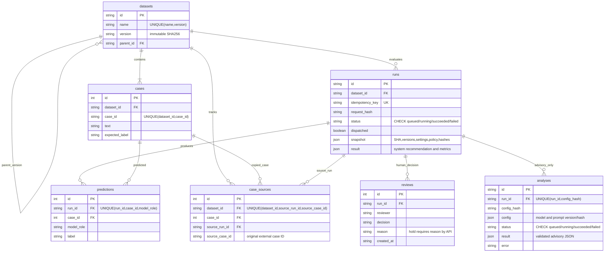

# AI 모델 변경 검증 플랫폼 · model-release-check

한국어 쇼핑몰 문의를 **배송 / 환불 / 결제 / 기타**로 분류하는 두 모델을 같은 평가 세트에서 비교합니다. 전체 정확도 상승과 함께 환불 품질 회귀·실패 원문을 확인하고 검토자의 최종 결정을 기록합니다. PR 검증 CLI, 별도 실패 분석, 출처를 보존하는 다음 평가 세트 생성을 포함한 AI 백엔드 포트폴리오 프로젝트입니다.

## 실행 · Docker Compose

필수: Docker Desktop(Compose v2). 기본 경로에는 외부 AI 토큰이 필요 없습니다.

```bash
cp .env.example .env
docker compose up --build -d
docker compose logs -f api worker
```

화면 http://localhost:8080 / API 문서 http://localhost:8000/docs

PostgreSQL·Redis 준비 → Alembic `0001 → 0002` → API·RQ 워커 순서로 시작합니다. 호스트 API·화면은 loopback에 바인딩하며 DB/Redis 포트는 공개하지 않습니다. `.env`는 Git에 포함하지 않습니다. 기본 비밀번호는 로컬 데모용입니다. `docker compose down`은 DB 볼륨을 보존합니다. `down -v`는 DB를 삭제합니다.

### Docker 없는 개발 실행

Python 3.12, Node.js 22 이상. 다음은 Bash 예시입니다.

```bash
python -m venv .venv
source .venv/bin/activate
pip install -r requirements.txt
alembic upgrade head
QUEUE_MODE=thread uvicorn backend.main:app --host 127.0.0.1 --port 8000
```

다른 터미널에서:

```bash
cd frontend
npm ci
npm run build
cd ..
python -m http.server 8080 --bind 127.0.0.1 --directory frontend/dist
```

PowerShell은 `.venv\Scripts\Activate.ps1`, `$env:QUEUE_MODE='thread'` 설정 후 `uvicorn ...`을 실행합니다. DATABASE_URL 생략 시 SQLite `local.db`입니다. PostgreSQL은 `postgresql+psycopg://...`, Redis는 REDIS_URL로 지정합니다.

**thread는 개발용 대체 모드**로 프로세스 종료 시 작업을 잃을 수 있습니다. Compose와 CI는 PostgreSQL + Redis + RQ입니다. 프런트 빌드는 Vite/Rollup + TypeScript 컴파일러로 구성해 네이티브 esbuild 자식 프로세스가 차단된 환경에서도 빌드합니다.

## 2분 기본 / 3분 PR 확장 데모

1. **0:00–0:30** 화면의 `고정 예측 시나리오`에서 샘플 평가를 실행합니다. `queued → running → succeeded`를 확인합니다. 빠른 작업은 폴링 사이에 완료될 수 있습니다.
2. **0:30–1:00** 정확도 **60% → 85%**, 환불 재현율 **100% → 60%**. 환불 최소 80%, 허용 하락 10%p를 위반해 **보류 권고**가 나옵니다.
3. **1:00–1:30** `기준만 정답` 필터로 eval-008, eval-009 원문을 확인하고 보류 사유를 저장합니다.
4. **1:30–2:00** 아래 CLI를 `--mode scenario`로 실행합니다. 종료 코드 **1**, JSON·Markdown 보고서를 확인합니다. 원격 PR 없이 PR 품질 검증 실패를 재현합니다.
5. **2:00–2:30** `검토용 분석 실행`의 기본 로컬 집계에서 `환불 → 기타 2건`을 확인하고 근거 ID를 클릭해 원문·두 예측을 봅니다.
6. **2:30–3:00** 두 실패 사례를 선택해 `다음 평가 세트에 추가`. 새 버전과 출처를 확인합니다. 원본에 이미 있는 사례이므로 사례는 20건을 유지하고 출처 2건을 추가합니다. 새 버전 선택 버튼으로 실제 로컬 모델 재평가를 준비합니다.

**고정 시나리오는 실제 모델 계산이 아닙니다.** `실제 로컬 모델 평가`는 키워드와 TF-IDF 모델의 결과를 그대로 표시합니다. 이번 로컬 실측은 정확도 **70% → 75%**, 환불 재현율 **100% → 100%**, 종료 코드 **0**입니다. 소규모 합성 데이터 결과를 실서비스 일반화 성능으로 해석하지 않습니다.

## PR 검증 CLI

API가 실행 중인 저장소 루트에서:

```bash
python -m scripts.pr_check \
  --dataset-version sample --commit-sha "$(git rev-parse HEAD)" \
  --mode scenario \
  --baseline-config '{"adapter":"keyword","rules_version":"v1"}' \
  --candidate-config '{"adapter":"local","C":4,"ngram_min":2,"ngram_max":4}' \
  --baseline-version keyword-v1 --candidate-version candidate-v1 \
  --refund-min-recall 0.8 --refund-max-drop 0.1 \
  --timeout 120 --output-dir reports/scenario

python -m scripts.pr_check --dataset-version sample --commit-sha local-demo-pr-001 --mode local --output-dir reports/local
```

- `--dataset-version`: 등록된 SHA256 버전. `sample`은 샘플 세트 등록/재사용 편의 값입니다.
- JSON은 인라인 객체 또는 `--candidate-config @config.json` 파일로 전달합니다. PowerShell은 파일 방식을 권장합니다.
- 후보 C, ngram_min/max는 **실제 학습 설정**을 바꿉니다. 기준은 현재 keyword/rules_version=v1만 지원하며 알 수 없는 설정은 422입니다.
- `--api-url`로 API를 바꿀 수 있습니다. timeout은 평가 요청·폴링의 제한이며 초기 데이터셋 조회는 별도 HTTP 30초 제한입니다.
- `report.json`: 실행 ID·스냅샷·양쪽 지표·클래스별 실제 건수·보류 사유·대표 실패 사례.
- `report.md`: Job Summary용 보고서. 문의의 HTML·표 문자를 이스케이프합니다.
- 종료 코드 **0**: 설정한 환불 정책 통과. **1**: 품질 미달 또는 환불 0건으로 평가 불가. **2**: API/작업 실패, 잘못된 설정, 시간 초과. CLI는 검토자의 최종 결정을 자동 작성하지 않습니다.

### 재실행과 버전 이름

`POST /run-specs`가 유효 설정을 정규화해 SHA256 지문을 반환하고 CLI는 `pr-{fingerprint}`를 멱등 키로 사용합니다. 지문에는 **커밋 SHA, 데이터셋 ID·버전, 실제 모델 설정, 학습 CSV 해시, 모델·평가 구현 해시, 판정 정책**이 포함됩니다. 시나리오는 고정 예측 파일 해시를 사용합니다.

같은 커밋·유효 설정은 기존 실행 ID를 재사용합니다. `--baseline-version`, `--candidate-version`, `--prompt-version`은 표시용 메타데이터여서 **이름 변경만으로 후보 설정이 달라졌다고 처리하지 않습니다**. 최초 실행의 이름을 스냅샷에 보존합니다. 현재 분류기는 사용자 프롬프트를 사용하지 않으므로 prompt-version은 표시용이며 분석 프롬프트는 별도 버전·본문 해시를 저장합니다. 시나리오에서 사용하지 않는 로컬 하이퍼파라미터는 지문을 바꾸지 않습니다.

실제 C 등 설정, 정책, 커밋, 데이터·구현이 바뀌면 새 실행입니다. 워커 시작 시 모델·평가 구현과 학습 버전 일치를 검사합니다. HF 모델 ID는 기록하지만 제공자가 같은 ID 뒤의 가중치를 바꾸는 것까지 검사하지 못하므로 재현성이 필요하면 고정 revision을 지원하는 ID/엔드포인트를 사용해야 합니다.

## GitHub Actions 설정

`.github/workflows/pr-quality.yml`은 pull_request 또는 수동 실행에서 PR **head SHA**를 체크아웃하고 Compose로 DB·Redis·마이그레이션·API·RQ 워커를 실행합니다. 합성 세트와 **실제 로컬 모델**로 CLI를 실행하며 별도 외부 AI 토큰이 필요 없습니다. CLI 종료 코드가 Job 결과에 반영되고 성공/실패 모두 Summary와 Artifact가 남습니다.

완료된 평가 DB는 커밋별 Actions cache 체크포인트로 저장·복원해 같은 PR 재실행의 실행 ID를 재사용합니다. 캐시 만료·삭제·브랜치 격리로 캐시가 없으면 새 DB에서 새 ID가 생성됩니다. 장기 보존은 동일 API·DB가 유지되는 환경이 필요합니다. 진행 중/실행 오류 보고서는 체크포인트로 저장하지 않습니다.

GitHub에서 Actions를 허용하고 `Model release quality gate / evaluate`를 필수 검사로 지정하면 됩니다. 고정 실패를 CI에서 보여주려면 `--mode local`을 `--mode scenario`로 변경합니다. pull_request_target이나 쓰기 권한은 사용하지 않습니다. **이번 작업에서는 원격 푸시 및 Actions 실제 실행을 하지 않았습니다.**

## API

| API | 역할 |
|---|---|
| POST /datasets | multipart file CSV 검증·불변 버전 등록 |
| POST /datasets/sample | 샘플 등록/재사용 |
| GET /datasets?version=SHA256 | 버전으로 찾기 |
| GET /datasets/{id} | 사례·부모 버전·원본 출처 |
| POST /run-specs | 유효 설정·지문 조회, 평가 실행 없음 |
| POST /runs | Idempotency-Key 필수, 202 + run_id |
| GET /runs/{id} | 상태·스냅샷·지표·비교 원문 |
| POST /runs/{id}/reviews | 완료 실행의 승인/보류 기록 |
| GET /runs/{id}/reviews | 검토 이력 조회 |
| POST /runs/{id}/analyses | 별도 작업, 202 + analysis_id |
| GET /runs/{id}/analyses | 분석 상태·설정·결과·오류 |
| POST /runs/{id}/dataset-versions | 선택 회귀 사례로 새 버전 |

```bash
curl -X POST http://localhost:8000/datasets/sample
curl -X POST http://localhost:8000/runs \
  -H 'Content-Type: application/json' -H 'Idempotency-Key: demo-001' \
  -d '{"dataset_id":"DATASET_ID","mode":"scenario","commit_sha":"demo-sha","policy":{"refund_min_recall":0.8,"refund_max_drop":0.1}}'
curl http://localhost:8000/runs/RUN_ID
curl -X POST http://localhost:8000/runs/RUN_ID/reviews \
  -H 'Content-Type: application/json' \
  -d '{"reviewer":"검토자","decision":"hold","reason":"환불 재현율 하락 및 두 회귀 원문 확인"}'
curl -X POST http://localhost:8000/runs/RUN_ID/analyses \
  -H 'Content-Type: application/json' -d '{"provider":"local"}'
curl http://localhost:8000/runs/RUN_ID/analyses
curl -X POST http://localhost:8000/runs/RUN_ID/dataset-versions \
  -H 'Content-Type: application/json' \
  -d '{"base_dataset_id":"DATASET_ID","case_ids":["eval-008","eval-009"]}'
```

화면은 `http://localhost:8080/?run=RUN_ID`로 CLI의 실행 결과도 열 수 있습니다. CSV는 UTF-8(BOM 허용), 헤더 case_id,text,expected_label이며 필수 값 누락·중복 ID·허용되지 않은 라벨은 422 + 행 번호·원인을 반환합니다. 빈 세트 거부, 최대 2MB. `data/train.csv`와 `evaluation.csv`의 원문은 분리되어 있습니다.

동일 멱등 키·동일 유효 요청은 기존 실행, 다른 요청은 409입니다. 큐 실패는 503과 dispatched=false로 남겨 같은 키로 재요청할 수 있습니다. DB 커밋·Redis 전송 사이 장애로 중복 전달될 수 있으나 예측 유니크 제약과 실행 행 잠금이 중복 저장을 막습니다. 2×전체 사례 수가 채워져야 완료됩니다. RQ 평가 2회·분석 1회 추가 재시도, 재시도 시 failed → running 가능. 강제 종료된 워커의 RQ 상태를 DB로 동기화하는 별도 감시자는 포함하지 않았습니다.

## 검토용 실패 분석

대상은 **기준 정답·후보 오답 사례만**입니다. 기본 `provider=local`은 정답→후보 라벨과 건수를 집계하며 **AI 추론이 아닙니다**. 선택 `provider=huggingface`는 HF_TOKEN, HF_ANALYSIS_MODEL_ID(없으면 기존 HF_MODEL_ID)를 재사용합니다. 분류와 대화 모델이 지원하는 작업이 다를 수 있어 분석 전용 ID를 지정할 수 있습니다.

HF 분류는 `candidate_config={"adapter":"huggingface","model_id":"..."}` 또는 기존 candidate_adapter=huggingface로 선택합니다. 토큰은 서버 환경변수에서만 읽고 스냅샷에 저장하지 않습니다. **HF 분류·생성 실제 호출은 미검증**이며 모든 AI 테스트는 가짜 공급자로 실행했습니다.

분석은 RQ 별도 작업·별도 테이블이며 품질 판정/최종 결정을 수정하지 않습니다. 고정 system 지시와 JSON untrusted_inquiries 데이터를 분리하고 **도구를 제공하거나 출력의 지시를 실행하는 루프가 없습니다**. 문의는 React 텍스트로 렌더링합니다. 엄격 Pydantic 스키마·추가 필드 금지·길이 제한·근거 ID의 회귀 대상 포함·중복 여부를 검사합니다. 세트에 있어도 회귀 대상이 아닌 ID를 인용하면 failed입니다. 최대 회귀 100건, 입력 40,000자 제한을 넘으면 실패합니다.

AI 응답 계약 예시(실제 분석 결과가 아님):

```json
{"patterns":[{"pattern":"복합 배송 지연·환불 문의가 배송으로 치우친 가설","evidence_ids":["제공된 회귀 사례 ID"],"improvement_hypotheses":["복합 의도 예시를 학습에 추가하고 별도 세트로 재검증"]}]}
```

고정 샘플의 관측 회귀는 **환불→기타**이며 위 복합 의도를 관측했다고 주장하지 않습니다. 스키마와 ID 검증은 가설의 사실성을 보장하지 않으므로 화면에 검토용으로 표시합니다.

## 다음 평가 세트 보존

기준 세트를 복제하고 선택 회귀 사례를 포함해 parent_id가 있는 자식 버전을 만듭니다. 원본 사례·버전·실행 결과를 바꾸지 않습니다. `(양끝 공백 제거한 원문, 기대 라벨)`로 중복을 제거하고 이미 있는 원문도 새 버전의 case_sources에 원본 실행 ID·사례 ID를 기록합니다. 같은 ID의 다른 원문에는 새 ID를 부여합니다. 같은 부모·실행·선택 집합은 같은 자식 ID를 반환합니다.

등록 버전은 CSV 바이트 SHA256, 파생 버전은 부모 ID·원본 실행·정렬 선택 집합의 SHA256입니다. 고정 시나리오는 원래 샘플 CSV 버전만 지원하며 새 세트는 실제 로컬 평가에 사용합니다.

## ERD와 제약



DB FK·유니크 제약은 관계와 재시도 중복을 보호합니다. 완료 후 검토·분석·세트 생성, 보류 사유 필수, 근거 대상 일치는 API/작업에서 검증합니다. Macro F1은 네 라벨을 항상 포함하고 표본 0 클래스 F1은 0입니다. 클래스 재현율은 표본 0이면 null/평가 불가. 환불 0건은 자동 통과하지 않습니다. 승인 권고는 설정한 환불 정책 통과를 뜻합니다.

## 테스트·검증·구조

```bash
pytest tests -q
python -m scripts.demo_extensions
```

demo_extensions는 먼저 CLI로 reports/scenario/report.json, reports/local/report.json을 만든 후 실행합니다. 실제 HTTP로 분석·검토·새 버전·중복 방지·원본 보존을 검증해 reports/demo-evidence.json에 저장합니다.

- 기존 테스트: CSV 오류, 멱등 재요청·키 충돌, 큐 실패 재요청, 워커 재시도·부분 결과 복구, 환불 기준·환불 없음, 완료 전 검토 거부, 학습/평가 분리.
- 추가 테스트: CLI 0/1/2·JSON/Markdown 저장, 동일 PR·표시 이름·실제 설정, AI 스키마/근거 ID 거부, 원문 지시를 데이터로 전달·도구 미제공, 분석 오류 시 판정·리뷰 유지, 분석 큐 재요청, 새 세트 중복 방지·출처·원본 보존, 마이그레이션 업/다운 데이터 보존.
- 결과 기록: reports/VALIDATION.md, reports/demo-evidence.json, reports/demo-ui.jpg 및 CLI 보고서.
- 이번 환경에는 Docker 실행 파일이 없어 **Compose·실제 PostgreSQL/Redis/RQ 통합 실행은 미검증**입니다. SQLite + thread 실제 HTTP, 워커 함수, 마이그레이션, 프런트 빌드를 검증했습니다. GitHub Actions·외부 HF 실제 호출도 미검증입니다.

| 경로 | 구현 / 기술 |
|---|---|
| backend/main.py | FastAPI·Pydantic API, 멱등성·리뷰·분석·세트 버전 |
| backend/db.py, migrations | SQLAlchemy·PostgreSQL·Alembic |
| backend/models.py, specs.py | 어댑터 Protocol, 키워드, 문자 n-gram TF-IDF + Logistic Regression, HF, 설정 지문 |
| backend/evaluation.py, analysis.py | Redis + RQ 작업, sklearn 지표·환불 판정·검토용 분석 |
| frontend | React + TypeScript + Vite 한국어 UI |
| scripts | PR CLI, 실제 HTTP 데모 검증 |
| .github/workflows/pr-quality.yml | PR head 검증, Summary·Artifact·DB 체크포인트 |
| tests | pytest·FastAPI TestClient·가짜 AI 공급자 |

외부 배포·원격 푸시·저장소 공개는 이번 추가 개발에서 수행하지 않았습니다.

참고: [RQ 재시도](https://python-rq.org/docs/exceptions/), [HF 추론 클라이언트](https://huggingface.co/docs/huggingface_hub/package_reference/inference_client), [GitHub Actions 변수](https://docs.github.com/en/actions/reference/workflows-and-actions/variables).
