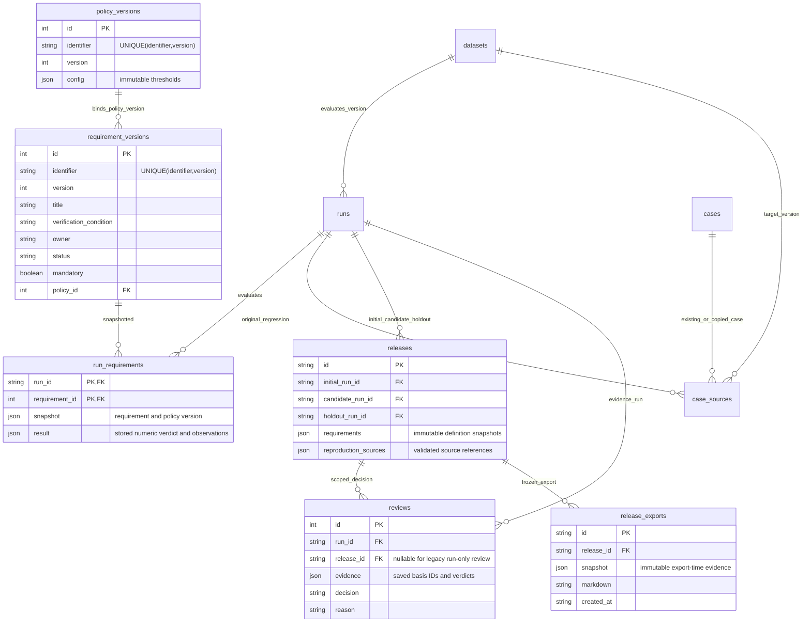
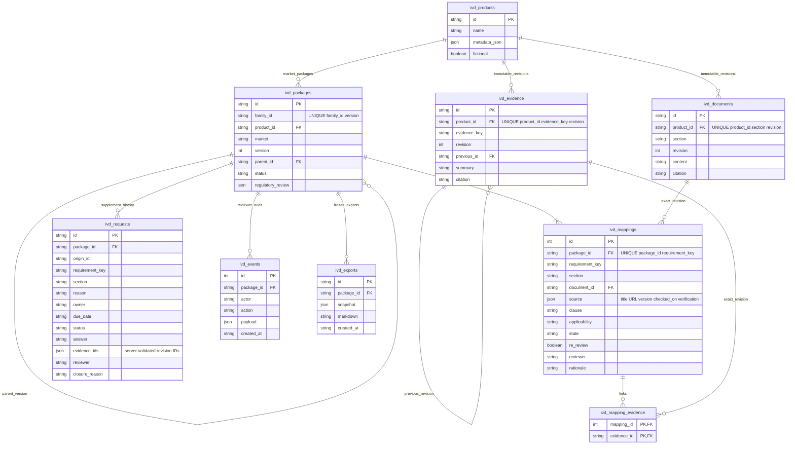
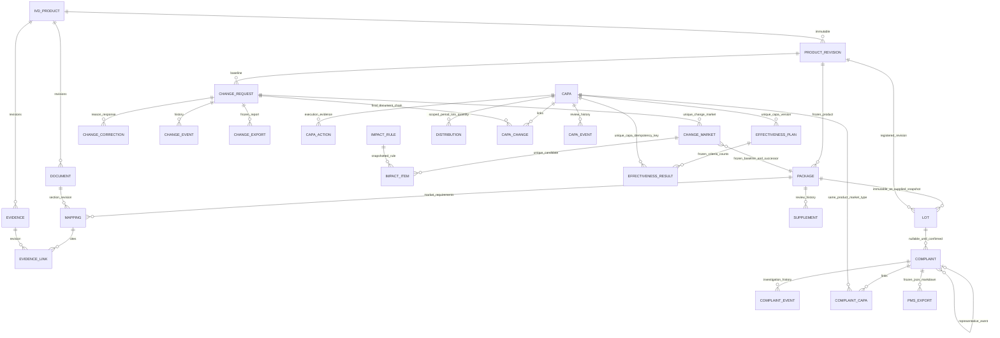

# AI 모델 변경 검증 플랫폼 · model-release-check

한국어 쇼핑몰 문의를 **배송 / 환불 / 결제 / 기타**로 분류하는 두 모델을 같은 평가 세트에서 비교합니다. 전체 정확도 상승과 함께 환불 품질 회귀·실패 원문을 확인하고 검토자의 최종 결정을 기록합니다. PR 검증 CLI, 별도 실패 분석, 출처를 보존하는 다음 평가 세트 생성을 포함한 AI 백엔드 포트폴리오 프로젝트입니다.

## 실행 · Docker Compose

필수: Docker Desktop(Compose v2). 기본 경로에는 외부 AI 토큰이 필요 없습니다.

```bash
cp .env.example .env
docker compose up --build -d
docker compose logs -f api worker
```

화면 http://localhost:8080 / API 문서 http://localhost:8000/docs

PostgreSQL·Redis 준비 → Alembic `0001 → 0002 → 0003 → 0004 → 0005 → 0006` → API·RQ 워커 순서로 시작합니다. 호스트 API·화면은 loopback에 바인딩하며 DB/Redis 포트는 공개하지 않습니다. `.env`는 Git에 포함하지 않습니다. 기본 비밀번호는 로컬 데모용입니다. `docker compose down`은 DB 볼륨을 보존합니다. `down -v`는 DB를 삭제합니다.

### Docker 없는 개발 실행

Python 3.12, Node.js 22 이상. 다음은 Bash 예시입니다.

```bash
python -m venv .venv
source .venv/bin/activate
pip install -r requirements.txt
alembic upgrade head
QUEUE_MODE=thread uvicorn backend.main:app --host 127.0.0.1 --port 8000
```

다른 터미널에서:

```bash
cd frontend
npm ci
npm run build
cd ..
python -m http.server 8080 --bind 127.0.0.1 --directory frontend/dist
```

PowerShell은 `.venv\Scripts\Activate.ps1`, `$env:QUEUE_MODE='thread'` 설정 후 `uvicorn ...`을 실행합니다. DATABASE_URL 생략 시 SQLite `local.db`입니다. PostgreSQL은 `postgresql+psycopg://...`, Redis는 REDIS_URL로 지정합니다.

**thread는 개발용 대체 모드**로 프로세스 종료 시 작업을 잃을 수 있습니다. Compose와 CI는 PostgreSQL + Redis + RQ입니다. 프런트 빌드는 Vite/Rollup + TypeScript 컴파일러로 구성해 네이티브 esbuild 자식 프로세스가 차단된 환경에서도 빌드합니다.

## 2분 기본 / 3분 PR 확장 데모

1. **0:00–0:30** 화면의 `고정 예측 시나리오`에서 샘플 평가를 실행합니다. `queued → running → succeeded`를 확인합니다. 빠른 작업은 폴링 사이에 완료될 수 있습니다.
2. **0:30–1:00** 정확도 **60% → 85%**, 환불 재현율 **100% → 60%**. 환불 최소 80%, 허용 하락 10%p를 위반해 **보류 권고**가 나옵니다.
3. **1:00–1:30** `기준만 정답` 필터로 eval-008, eval-009 원문을 확인하고 보류 사유를 저장합니다.
4. **1:30–2:00** 아래 CLI를 `--mode scenario`로 실행합니다. 종료 코드 **1**, JSON·Markdown 보고서를 확인합니다. 원격 PR 없이 PR 품질 검증 실패를 재현합니다.
5. **2:00–2:30** `검토용 분석 실행`의 기본 로컬 집계에서 `환불 → 기타 2건`을 확인하고 근거 ID를 클릭해 원문·두 예측을 봅니다.
6. **2:30–3:00** 두 실패 사례를 선택해 `다음 평가 세트에 추가`. 새 버전과 출처를 확인합니다. 원본에 이미 있는 사례이므로 사례는 20건을 유지하고 출처 2건을 추가합니다. 새 버전 선택 버튼으로 실제 로컬 모델 재평가를 준비합니다.

**고정 시나리오는 실제 모델 계산이 아닙니다.** `실제 로컬 모델 평가`는 키워드와 TF-IDF 모델의 결과를 그대로 표시합니다. 이번 로컬 실측은 정확도 **70% → 75%**, 환불 재현율 **100% → 100%**, 종료 코드 **0**입니다. 소규모 합성 데이터 결과를 실서비스 일반화 성능으로 해석하지 않습니다.

## PR 검증 CLI

API가 실행 중인 저장소 루트에서:

```bash
python -m scripts.pr_check \
  --dataset-version sample --commit-sha "$(git rev-parse HEAD)" \
  --mode scenario \
  --baseline-config '{"adapter":"keyword","rules_version":"v1"}' \
  --candidate-config '{"adapter":"local","C":4,"ngram_min":2,"ngram_max":4}' \
  --baseline-version keyword-v1 --candidate-version candidate-v1 \
  --refund-min-recall 0.8 --refund-max-drop 0.1 \
  --timeout 120 --output-dir reports/scenario

python -m scripts.pr_check --dataset-version sample --commit-sha local-demo-pr-001 --mode local --output-dir reports/local
```

- `--dataset-version`: 등록된 SHA256 버전. `sample`은 샘플 세트 등록/재사용 편의 값입니다.
- JSON은 인라인 객체 또는 `--candidate-config @config.json` 파일로 전달합니다. PowerShell은 파일 방식을 권장합니다.
- 후보 C, ngram_min/max는 **실제 학습 설정**을 바꿉니다. 기준은 현재 keyword/rules_version=v1만 지원하며 알 수 없는 설정은 422입니다.
- `--api-url`로 API를 바꿀 수 있습니다. timeout은 평가 요청·폴링의 제한이며 초기 데이터셋 조회는 별도 HTTP 30초 제한입니다.
- `report.json`: 실행 ID·스냅샷·양쪽 지표·클래스별 실제 건수·보류 사유·대표 실패 사례.
- `report.md`: Job Summary용 보고서. 문의의 HTML·표 문자를 이스케이프합니다.
- 종료 코드 **0**: 설정한 환불 정책 통과. **1**: 품질 미달 또는 환불 0건으로 평가 불가. **2**: API/작업 실패, 잘못된 설정, 시간 초과. CLI는 검토자의 최종 결정을 자동 작성하지 않습니다.

### 재실행과 버전 이름

`POST /run-specs`가 유효 설정을 정규화해 SHA256 지문을 반환하고 CLI는 `pr-{fingerprint}`를 멱등 키로 사용합니다. 지문에는 **커밋 SHA, 데이터셋 ID·버전, 실제 모델 설정, 학습 CSV 해시, 모델·평가 구현 해시, 판정 정책**이 포함됩니다. 시나리오는 고정 예측 파일 해시를 사용합니다.

같은 커밋·유효 설정은 기존 실행 ID를 재사용합니다. `--baseline-version`, `--candidate-version`, `--prompt-version`은 표시용 메타데이터여서 **이름 변경만으로 후보 설정이 달라졌다고 처리하지 않습니다**. 최초 실행의 이름을 스냅샷에 보존합니다. 현재 분류기는 사용자 프롬프트를 사용하지 않으므로 prompt-version은 표시용이며 분석 프롬프트는 별도 버전·본문 해시를 저장합니다. 시나리오에서 사용하지 않는 로컬 하이퍼파라미터는 지문을 바꾸지 않습니다.

실제 C 등 설정, 정책, 커밋, 데이터·구현이 바뀌면 새 실행입니다. 워커 시작 시 모델·평가 구현과 학습 버전 일치를 검사합니다. HF 모델 ID는 기록하지만 제공자가 같은 ID 뒤의 가중치를 바꾸는 것까지 검사하지 못하므로 재현성이 필요하면 고정 revision을 지원하는 ID/엔드포인트를 사용해야 합니다.

## GitHub Actions 설정

`.github/workflows/pr-quality.yml`은 pull_request 또는 수동 실행에서 PR **head SHA**를 체크아웃하고 Compose로 DB·Redis·마이그레이션·API·RQ 워커를 실행합니다. 합성 세트와 **실제 로컬 모델**로 CLI를 실행하며 별도 외부 AI 토큰이 필요 없습니다. CLI 종료 코드가 Job 결과에 반영되고 성공/실패 모두 Summary와 Artifact가 남습니다.

완료된 평가 DB는 커밋별 Actions cache 체크포인트로 저장·복원해 같은 PR 재실행의 실행 ID를 재사용합니다. 캐시 만료·삭제·브랜치 격리로 캐시가 없으면 새 DB에서 새 ID가 생성됩니다. 장기 보존은 동일 API·DB가 유지되는 환경이 필요합니다. 진행 중/실행 오류 보고서는 체크포인트로 저장하지 않습니다.

GitHub에서 Actions를 허용하고 `Model release quality gate / evaluate`를 필수 검사로 지정하면 됩니다. 고정 실패를 CI에서 보여주려면 `--mode local`을 `--mode scenario`로 변경합니다. pull_request_target이나 쓰기 권한은 사용하지 않습니다. **이번 작업에서는 원격 푸시 및 Actions 실제 실행을 하지 않았습니다.**

## API

| API | 역할 |
|---|---|
| POST /datasets | multipart file CSV 검증·불변 버전 등록 |
| POST /datasets/sample | 샘플 등록/재사용 |
| GET /datasets?version=SHA256 | 버전으로 찾기 |
| GET /datasets/{id} | 사례·부모 버전·원본 출처 |
| POST /run-specs | 유효 설정·지문 조회, 평가 실행 없음 |
| POST /runs | Idempotency-Key 필수, 202 + run_id |
| GET /runs/{id} | 상태·스냅샷·지표·비교 원문 |
| POST /runs/{id}/reviews | 완료 실행의 승인/보류 기록 |
| GET /runs/{id}/reviews | 검토 이력 조회 |
| POST /runs/{id}/analyses | 별도 작업, 202 + analysis_id |
| GET /runs/{id}/analyses | 분석 상태·설정·결과·오류 |
| POST /runs/{id}/dataset-versions | 선택 회귀 사례로 새 버전 |

```bash
curl -X POST http://localhost:8000/datasets/sample
curl -X POST http://localhost:8000/runs \
  -H 'Content-Type: application/json' -H 'Idempotency-Key: demo-001' \
  -d '{"dataset_id":"DATASET_ID","mode":"scenario","commit_sha":"demo-sha","policy":{"refund_min_recall":0.8,"refund_max_drop":0.1}}'
curl http://localhost:8000/runs/RUN_ID
curl -X POST http://localhost:8000/runs/RUN_ID/reviews \
  -H 'Content-Type: application/json' \
  -d '{"reviewer":"검토자","decision":"hold","reason":"환불 재현율 하락 및 두 회귀 원문 확인"}'
curl -X POST http://localhost:8000/runs/RUN_ID/analyses \
  -H 'Content-Type: application/json' -d '{"provider":"local"}'
curl http://localhost:8000/runs/RUN_ID/analyses
curl -X POST http://localhost:8000/runs/RUN_ID/dataset-versions \
  -H 'Content-Type: application/json' \
  -d '{"base_dataset_id":"DATASET_ID","case_ids":["eval-008","eval-009"]}'
```

화면은 `http://localhost:8080/?run=RUN_ID`로 CLI의 실행 결과도 열 수 있습니다. CSV는 UTF-8(BOM 허용), 헤더 case_id,text,expected_label이며 필수 값 누락·중복 ID·허용되지 않은 라벨은 422 + 행 번호·원인을 반환합니다. 빈 세트 거부, 최대 2MB. `data/train.csv`와 `evaluation.csv`의 원문은 분리되어 있습니다.

동일 멱등 키·동일 유효 요청은 기존 실행, 다른 요청은 409입니다. 큐 실패는 503과 dispatched=false로 남겨 같은 키로 재요청할 수 있습니다. DB 커밋·Redis 전송 사이 장애로 중복 전달될 수 있으나 예측 유니크 제약과 실행 행 잠금이 중복 저장을 막습니다. 2×전체 사례 수가 채워져야 완료됩니다. RQ 평가 2회·분석 1회 추가 재시도, 재시도 시 failed → running 가능. 강제 종료된 워커의 RQ 상태를 DB로 동기화하는 별도 감시자는 포함하지 않았습니다.

## 검토용 실패 분석

대상은 **기준 정답·후보 오답 사례만**입니다. 기본 `provider=local`은 정답→후보 라벨과 건수를 집계하며 **AI 추론이 아닙니다**. 선택 `provider=huggingface`는 HF_TOKEN, HF_ANALYSIS_MODEL_ID(없으면 기존 HF_MODEL_ID)를 재사용합니다. 분류와 대화 모델이 지원하는 작업이 다를 수 있어 분석 전용 ID를 지정할 수 있습니다.

HF 분류는 `candidate_config={"adapter":"huggingface","model_id":"..."}` 또는 기존 candidate_adapter=huggingface로 선택합니다. 토큰은 서버 환경변수에서만 읽고 스냅샷에 저장하지 않습니다. **HF 분류·생성 실제 호출은 미검증**이며 모든 AI 테스트는 가짜 공급자로 실행했습니다.

분석은 RQ 별도 작업·별도 테이블이며 품질 판정/최종 결정을 수정하지 않습니다. 고정 system 지시와 JSON untrusted_inquiries 데이터를 분리하고 **도구를 제공하거나 출력의 지시를 실행하는 루프가 없습니다**. 문의는 React 텍스트로 렌더링합니다. 엄격 Pydantic 스키마·추가 필드 금지·길이 제한·근거 ID의 회귀 대상 포함·중복 여부를 검사합니다. 세트에 있어도 회귀 대상이 아닌 ID를 인용하면 failed입니다. 최대 회귀 100건, 입력 40,000자 제한을 넘으면 실패합니다.

AI 응답 계약 예시(실제 분석 결과가 아님):

```json
{"patterns":[{"pattern":"복합 배송 지연·환불 문의가 배송으로 치우친 가설","evidence_ids":["제공된 회귀 사례 ID"],"improvement_hypotheses":["복합 의도 예시를 학습에 추가하고 별도 세트로 재검증"]}]}
```

고정 샘플의 관측 회귀는 **환불→기타**이며 위 복합 의도를 관측했다고 주장하지 않습니다. 스키마와 ID 검증은 가설의 사실성을 보장하지 않으므로 화면에 검토용으로 표시합니다.

## 다음 평가 세트 보존

기준 세트를 복제하고 선택 회귀 사례를 포함해 parent_id가 있는 자식 버전을 만듭니다. 원본 사례·버전·실행 결과를 바꾸지 않습니다. `(양끝 공백 제거한 원문, 기대 라벨)`로 중복을 제거하고 이미 있는 원문도 새 버전의 case_sources에 원본 실행 ID·사례 ID를 기록합니다. 같은 ID의 다른 원문에는 새 ID를 부여합니다. 같은 부모·실행·선택 집합은 같은 자식 ID를 반환합니다.

등록 버전은 CSV 바이트 SHA256, 파생 버전은 부모 ID·원본 실행·정렬 선택 집합의 SHA256입니다. 고정 시나리오는 원래 샘플 CSV 버전만 지원하며 새 세트는 실제 로컬 평가에 사용합니다.

## ERD와 제약


DB FK·유니크 제약은 관계와 재시도 중복을 보호합니다. 완료 후 검토·분석·세트 생성, 보류 사유 필수, 근거 대상 일치는 API/작업에서 검증합니다. Macro F1은 네 라벨을 항상 포함하고 표본 0 클래스 F1은 0입니다. 클래스 재현율은 표본 0이면 null/평가 불가. 환불 0건은 자동 통과하지 않습니다. 승인 권고는 설정한 환불 정책 통과를 뜻합니다.

## 테스트·검증·구조

```bash
pytest tests -q
python -m scripts.demo_extensions
```

demo_extensions는 먼저 CLI로 reports/scenario/report.json, reports/local/report.json을 만든 후 실행합니다. 실제 HTTP로 분석·검토·새 버전·중복 방지·원본 보존을 검증해 reports/demo-evidence.json에 저장합니다.

- 기존 테스트: CSV 오류, 멱등 재요청·키 충돌, 큐 실패 재요청, 워커 재시도·부분 결과 복구, 환불 기준·환불 없음, 완료 전 검토 거부, 학습/평가 분리.
- 추가 테스트: CLI 0/1/2·JSON/Markdown 저장, 동일 PR·표시 이름·실제 설정, AI 스키마/근거 ID 거부, 원문 지시를 데이터로 전달·도구 미제공, 분석 오류 시 판정·리뷰 유지, 분석 큐 재요청, 새 세트 중복 방지·출처·원본 보존, 마이그레이션 업/다운 데이터 보존.
- 결과 기록: reports/VALIDATION.md, reports/demo-evidence.json, reports/demo-ui.jpg 및 CLI 보고서.
- 이번 환경에는 Docker 실행 파일이 없어 **Compose·실제 PostgreSQL/Redis/RQ 통합 실행은 미검증**입니다. SQLite + thread 실제 HTTP, 워커 함수, 마이그레이션, 프런트 빌드를 검증했습니다. GitHub Actions·외부 HF 실제 호출도 미검증입니다.

| 경로 | 구현 / 기술 |
|---|---|
| backend/main.py | FastAPI·Pydantic API, 멱등성·리뷰·분석·세트 버전 |
| backend/db.py, migrations | SQLAlchemy·PostgreSQL·Alembic |
| backend/models.py, specs.py | 어댑터 Protocol, 키워드, 문자 n-gram TF-IDF + Logistic Regression, HF, 설정 지문 |
| backend/evaluation.py, analysis.py | Redis + RQ 작업, sklearn 지표·환불 판정·검토용 분석 |
| frontend | React + TypeScript + Vite 한국어 UI |
| scripts | PR CLI, 실제 HTTP 데모 검증 |
| .github/workflows/pr-quality.yml | PR head 검증, Summary·Artifact·DB 체크포인트 |
| tests | pytest·FastAPI TestClient·가짜 AI 공급자 |

외부 배포·원격 푸시·저장소 공개는 이번 추가 개발에서 수행하지 않았습니다.

참고: [RQ 재시도](https://python-rq.org/docs/exceptions/), [HF 추론 클라이언트](https://huggingface.co/docs/huggingface_hub/package_reference/inference_client), [GitHub Actions 변수](https://docs.github.com/en/actions/reference/workflows-and-actions/variables).

## 3차 개발: 요구사항 추적·재검증·릴리스 증빙

요구사항·정책은 **불변 버전**으로 저장합니다. ID와 버전이 같은데 필드가 달라지면 409입니다. 개정은 새 버전 등록으로만 가능합니다. 요구사항 필드는 ID, 버전, 제목, 검증 조건, 담당자, 상태(draft/active/retired), 필수 여부, 정책 ID·버전입니다. 수치 기준의 권위 있는 값은 연결된 정책의 config이며 검증 조건은 사람을 위한 설명입니다.

`REQ-REFUND-001 v1`은 후보 환불 재현율 **85% 이상**, 기준 대비 하락 **5%p 이하**를 `POL-REFUND-001 v1`에 연결합니다. `POST /requirements/sample` 또는 화면의 예시 등록으로 등록합니다. 요구사항을 평가에 전달하면 연결된 정책을 사용합니다. 여러 요구사항은 최소 재현율의 최댓값·허용 하락의 최솟값으로 통합해 기존 `compare()`를 실행하며 각 요구사항도 같은 로직으로 별도 판정합니다. 이 경우 일반 policy 인자보다 요구사항 정책이 우선합니다.

실행 스냅샷과 run_requirements에 요구사항 정의·정책 버전을 복사하고, 워커가 관측값·판정·위반 사례 ID를 **완료 시점에 저장**합니다. 조회 시 최신 정책으로 재계산하지 않습니다. 예전 실행에 요구사항을 사후 소급해 붙이지 않습니다. 연결된 완료 평가가 없으면 **미검증**, 환불 표본 0건이면 **평가 불가**입니다.

### 요구사항 정의·근거 테스트

| ID | 버전 / 검증 조건 | 근거 테스트 |
|---|---|---|
| REQ-REFUND-001 | v1: 환불 재현율 ≥85%, 하락 ≤5%p | test_requirement_policy_snapshots_survive_revision, test_required_nonpass_blocks_release_approval |
| REQ-TRACE-001 | 실행 시점 요구사항·정책·판정 보존 | test_requirement_policy_snapshots_survive_revision |
| REQ-REGRESSION-001 | 원본 실행·사례·대상 세트 버전 연결, 중복 없음 | test_regression_links_deduplicate_without_changing_dataset |
| REQ-COMPARE-001 | 같은 세트·정책에서만 직접 지표 증감 제공 | test_dataset_or_policy_version_change_disables_direct_comparison |
| REQ-REVIEW-001 | 필수 실패/미검증/평가 불가이면 릴리스 일반 승인 제한 | test_required_nonpass_blocks_release_approval, test_run_only_review_cannot_override_release_gate |
| REQ-EVIDENCE-001 | 보고서 ID·버전·지표가 저장된 실행과 일치, 내보낸 증빙 불변 | test_same_conditions_correction_comparison_review_and_frozen_report |
| REQ-HOLDOUT-001 | 재현 사례와 수정 미사용·독립 평가 성능 분리 | test_holdout_with_used_cases_is_not_independent, test_separate_unused_holdout_is_reported_independently |

위 표에서 REQ-REFUND-001은 API에 등록하는 모델 품질 요구사항입니다. 나머지 ID는 구현 기능의 추적성 정의이며 임의의 수치 정책에 매핑해 DB에 등록하지 않습니다.

### 실행 명령과 3분 데모

기존 DB에서도 먼저 증분 마이그레이션을 적용합니다. 기존 평가·리뷰는 보존됩니다.

```bash
alembic upgrade head
QUEUE_MODE=thread uvicorn backend.main:app --host 127.0.0.1 --port 8000
# 다른 터미널: 실제 HTTP 전체 흐름과 파일 생성
python -m scripts.demo_traceability
pytest tests -q
```

Compose는 기존 `docker compose up --build -d`를 그대로 사용합니다. 화면 빌드도 `cd frontend && npm ci && npm run build`와 동일합니다. 스크립트는 `reports/traceability/demo.json`, `original-pr.json/md`, `repaired-pr.json/md`, `release.json/md`를 생성합니다. 결과 화면 주소는 demo.json의 url에 저장됩니다.

1. **0:00–0:30** 화면 상단 `예시 요구사항 등록` → REQ-REFUND-001 v1 선택. 적용 기준 85%·5%p와 미검증 표시를 확인합니다.
2. **0:30–1:00** `1. 환불 기준 위반 평가`. **시나리오 데모** 정확도 기준 60%·후보 85%, 후보 환불 60% → 요구사항 실패. 근거 실행 버튼과 eval-008/009 원문을 확인합니다.
3. **1:00–1:30** 두 사례를 선택하고 `2. 선택 사례 회귀 연결`. 기존 세트에 있는 원문이므로 **사례 추가 0건·출처 연결 2건**, 버전 유지입니다.
4. **1:30–2:00** `3. 동일 조건 수정 후보 평가` → `4. 릴리스 검토 생성`. 같은 데이터셋·정책에서 후보 정확도 **85% → 95%**, 환불 **60% → 100%**, 재현 사례 2건 통과를 확인합니다.
5. **2:00–2:30** 시스템 통과와 검토자 결정을 구분해 사유와 일반 승인을 저장합니다. 실패 실행으로 릴리스를 만들면 일반 승인은 제한됩니다(API 409). 보류 사유를 기록할 수 있습니다.
6. **2:30–3:00** `6. 릴리스 검토 보고서 내보내기` → JSON·Markdown 다운로드. 요구사항/정책 버전, 두 실행 ID·커밋·세트·모델 설정, 위반 기준, 재현 사례, 검토 결정·사유를 확인합니다.

`data/scenario_repaired.json`은 두 환불 회귀만 수정한 **별도 고정 예측**입니다. 실제 모델 개선으로 해석하지 않습니다. 수정에 사용하지 않은 18건은 정확도 94.4%, 환불 100%(3건)로 표시하지만 **독립 세트는 아닙니다**. 별도 독립 평가 실행이 없으면 미검증입니다. 수정한 사례의 통과를 일반화 성능으로 표시하지 않습니다.

### 추가 API / CLI

| API | 역할 |
|---|---|
| POST /policies | 정책 ID·버전·수치 config 불변 등록 |
| POST /requirements, POST /requirements/sample | 정의 버전 등록, 예시 생성 |
| GET /requirements | 전체 요구사항 버전 목록 |
| GET /requirements/{identifier}/versions/{version} | 실행 시점 기준·관측값·판정·위반 원문·출처 |
| POST /runs/{id}/regression-links | 기존 대상 세트 사례에 출처만 연결 |
| POST /releases, GET /releases, GET /releases/{id} | 최초/수정/독립 실행과 요구사항 범위·비교·추적표 |
| POST /releases/{id}/reviews | 기존 reviews 테이블을 재사용해 릴리스 결정 및 근거 저장 |
| POST /releases/{id}/exports | JSON·Markdown 증빙 스냅샷 생성 |
| GET /release-exports/{id}?format=json 또는 markdown | 저장된 증빙 다운로드 |

평가·PR CLI에 요구사항을 연결하는 예시:

```bash
curl -X POST http://localhost:8000/requirements/sample
python -m scripts.pr_check --dataset-version sample --commit-sha scenario-original-demo \
  --mode scenario --scenario-variant original --requirement REQ-REFUND-001@1 \
  --output-dir reports/trace-original
python -m scripts.pr_check --dataset-version sample --commit-sha scenario-repaired-demo \
  --mode scenario --scenario-variant repaired --requirement REQ-REFUND-001@1 \
  --output-dir reports/trace-repaired
```

기존 POST /runs의 추가 필드:

```json
{"dataset_id":"DATASET_ID","mode":"scenario","scenario_variant":"repaired","commit_sha":"scenario-repaired-demo","requirements":[{"identifier":"REQ-REFUND-001","version":1}]}
```

릴리스 생성 예시:

```json
{"name":"환불 수정 검토","initial_run_id":"INITIAL_RUN_ID","candidate_run_id":"CANDIDATE_RUN_ID","requirements":[{"identifier":"REQ-REFUND-001","version":1}],"reproduction_sources":[{"source_run_id":"INITIAL_RUN_ID","source_case_id":"eval-008"}]}
```

reproduction_sources는 먼저 대상 세트에 CaseSource로 연결되어야 합니다. 없는 원문을 기존 세트에 삽입하지 않으며 기존 dataset-versions API로 새 버전을 만든 뒤 사용할 수 있습니다. 버전이 달라지면 전체 정확도·환불 증감 비교는 제한하고 원문 재현 결과만 별도 제공합니다.

직접 비교 조건은 두 실행 완료, **같은 테스트 세트 버전·같은 정책 수치와 버전·같은 평가 모드·같은 기준 모델 설정**입니다. 다르면 `comparison.allowed=false`, deltas=null과 제한 사유를 반환합니다. 양쪽 원래 지표와 설정은 조회할 수 있습니다.

`holdout_run_id`는 별도 독립 평가 근거를 연결하는 선택 필드입니다. 수정 사용 원문 중복 없음, 별도 세트 버전, 같은 후보 설정·커밋·정책인지 검사합니다. 불일치는 평가 불가입니다. 이 검사는 제공된 재현 출처 범위에 한하며, 사람의 미기록 학습 사용이나 의미가 비슷한 문장의 누출까지 증명하지 않습니다.

일반 승인은 **해당 릴리스에 포함된 필수 요구사항의 정확한 버전**이 모두 통과하고 수정 후보가 완료된 경우에만 가능합니다. draft/retired는 통과로 계산하지 않습니다. 제한 시 API 409에 restrictions를 포함하고 UI에서 사유·승인 비활성화를 표시합니다. 별도 독립 평가까지 반드시 통과해야 한다는 추가 정책은 현재 요구하지 않으며, 독립 미검증 상태를 분명히 표시합니다.

기존 `/runs/{id}/reviews`의 실행 단독 기록은 릴리스 승인을 대체하지 않습니다. 릴리스 검토에는 같은 reviews 테이블의 release_id, run_id와 evidence JSON(최초/후보/독립 실행 ID, 요구사항 판정)을 저장합니다. 내보낸 release_exports는 생성 시점의 요구사항·실행·결정 전체를 저장하여 이후 정책 개정·추가 결정에 따라 변하지 않습니다. 새로운 검토를 반영하려면 새 보고서를 생성합니다.

### 확장 ERD



release.requirements와 reproduction_sources는 관계 FK 대신 API로 검증한 **JSON 스냅샷**입니다. 실행별 요구사항 연결은 복합 PK로 중복을 막습니다. CaseSource의 기존 `(dataset_id, source_run_id, source_case_id)` 유니크 제약을 그대로 사용합니다. DB를 직접 변경하는 관리 작업까지 막는 불변 트리거는 없으며 불변성은 공개 API의 생성 전용 인터페이스와 저장된 스냅샷으로 보장합니다.

이번 검증은 SQLite + thread 실제 HTTP·화면·CLI, Alembic 0003, pytest, 프런트 빌드에서 수행했습니다. Docker/PostgreSQL/Redis/RQ 실제 통합, GitHub Actions, HF 외부 호출은 이전과 마찬가지로 미검증이며 원격 푸시·외부 배포를 하지 않았습니다. 자세한 변경 파일과 실측은 `reports/traceability/VALIDATION.md`를 참조하세요.

## IVD 확장: 시장별 문서 패키지·증빙·보완 대응

사용자가 지정한 현재 저장소에는 기존 IVD 모델과 HIV/COVID 가상 데이터가 없었습니다. 따라서 기존 FastAPI·SQLAlchemy Base/Session·Alembic·React·Markdown/JSON 내보내기 구성을 활용하되, 평가 실행에 강제 연결하지 않는 최소 `ivd_*` 도메인 테이블과 가상 메타데이터를 추가했습니다. 기존 제품 데이터를 재사용했다고 주장하지 않습니다. 기존 AI 모델 평가와 요구사항·릴리스 기능은 유지합니다.

화면: **http://localhost:8080/?ivd=1**. 가상 HIV 항원·항체 검사 제품과 COVID-19 항원 검사 제품만 제공하며 실제 제품 성능·시험 결과·등급을 생성하지 않습니다.

### 공식 근거 확인 범위 (2026-11-24)

| 시장 | 근거·버전 | 확인 결과 / 남은 항목 |
|---|---|---|
| EU | Regulation (EU) 2017/746, CELEX 32017R0746 / 통합문 02017R0746-20250110 | EUR-Lex 원문에서 번호·문서 제목 대조. Annex II 제품 설명·사용 목적·기술문서, Annex I 20.2 표시사항, Annex II 6 및 Annex XIII 성능평가 참조 확인. 제품별 분류·적용·경로는 미확정 |
| 국내 | 체외진단의료기기 허가ㆍ신고ㆍ심사 등에 관한 규정 / 식약처고시 제2026-58호, 시행 2026-08-10 | 국가법령정보센터에서 제목·버전, 식약처 공고에서 개정 설명 확인. 첨부 전문의 조항별 원문·별표 대조는 미확인 |
| 국내 로컬 데모 | VIRTUAL-KR-001 / demo-v1 | **별도 가상 검토 기준**. 위 고시의 적용성을 확정한 데이터가 아님 |

- [EUR-Lex 원 제정문](https://eur-lex.europa.eu/legal-content/EN/TXT/?uri=CELEX:32017R0746)
- [EUR-Lex 확인한 통합문](https://eur-lex.europa.eu/legal-content/EN/TXT/?uri=CELEX:02017R0746-20250110)
- [국가법령정보센터 고시](https://www.law.go.kr/admRulLsInfoP.do?admRulSeq=2100000283814)
- [식약처 개정 공고](https://www.mfds.go.kr/law/board/boardDetail.do?brdId=data0008&menuKey=28&seq=15186)

`data/ivd_sources.json`에 공식 URL·제목·법령 번호·문서 버전·확인일·확인 범위·미확인 목록을 기록했습니다. 원문을 확인했다는 것은 특정 제품에 적용된다는 뜻이 아닙니다. 이는 전체 인허가 요구사항을 망라하는 템플릿이 아니라 **5개 섹션을 묶는 검토 시작점**입니다. 분류·경로·면제·개별 적용 여부는 검토자가 제품 정보와 최신 공식 근거를 대조해야 합니다.

### 요구사항 정의표

| ID | 검증 조건 | 근거 테스트 |
|---|---|---|
| IVD-SOURCE-001 | 미확인 근거의 등급·경로·적용 자동 확정 금지 | test_unverified_source_never_auto_confirmed |
| IVD-MAP-001 | 요구사항→문서 개정본→증빙 개정본→상태, 제품 ID 검증 | test_cross_product_documents_evidence_rejected |
| IVD-NA-001 | 해당 없음에 검토자 판단 근거 필수 | test_not_applicable_requires_reason |
| IVD-SUP-001 | 요청→답변 등록/재검토 대기→재검토→종결 순서, 열린 건 완료 제한 | test_full_supplement_cycle_and_open_request_blocks_completion |
| IVD-VERSION-001 | 증빙·문서 교체는 새 패키지 버전, 영향 요구사항 재검토 필요, 이전 참조 보존 | test_revision_preserves_previous_package_and_market_independence |
| IVD-EXPORT-001 | 키 없이 초안/완료 JSON·Markdown, 상태·미해결·가상 워터마크 포함 | test_draft_export_frozen_and_without_key |
| IVD-AI-001 | AI 문장별 문서·증빙 ID를 해당 패키지 범위에서 검증, 수정 저장 시 재검증 | test_ai_sentence_citations_package_scope, test_edited_ai_reply_revalidated_on_save |
| IVD-MIGRATION-001 | 기존 평가·리뷰를 보존하는 0004 업/다운 | test_ivd_migration_preserves_existing_data_and_enforces_evidence_links |

패키지에는 시장별 `EU-OVERVIEW-001`, `EU-INTENDED_USE-001`, `EU-PERFORMANCE-001`, `EU-LABELING-001`, `EU-EVIDENCE_INDEX-001` 또는 KR 접두어 요구사항이 생성됩니다. 각 항목에 근거 스냅샷·조항·필수 여부·적용 여부·검토자·판단 사유를 저장합니다. 상태는 **검토 필요 / 자료 누락 / 검토 중 / 충족 / 해당 없음**이며 증빙·문서 교체의 재검토 플래그는 화면에서 **재검토 필요**로 표시합니다.

### 마이그레이션과 실행

```bash
alembic upgrade head
# 0001 → 0002 → 0003 → 0004
QUEUE_MODE=thread uvicorn backend.main:app --host 127.0.0.1 --port 8000
# 다른 터미널
python -m scripts.demo_ivd
pytest tests -q
cd frontend
npm ci
npm run build
cd ..
python -m http.server 8080 --bind 127.0.0.1 --directory frontend/dist
```

PowerShell은 `$env:QUEUE_MODE='thread'`로 설정합니다. Compose 실행은 기존 `docker compose up --build -d`와 동일합니다. IVD 작업은 내부 메타데이터·사람 검토 API이며 모델 평가 RQ 작업과 별개입니다. 선택 AI 초안만 HF 호출을 사용합니다.

### 두 제품의 로컬 데모

`python -m scripts.demo_ivd`는 실제 HTTP로 아래 흐름을 수행합니다. API 키는 필요 없습니다.

1. 가상 HIV·COVID 데이터 등록. HIV EU 패키지와 HIV 국내·COVID 국내 패키지를 각각 생성합니다. 국내는 별도 **가상 검토 기준**을 명시합니다.
2. HIV EU의 성능평가 자료 누락 확인 → 특정 요구사항에 보완 요청(사유·담당자·기한) → 초안 v1 내보내기.
3. 성능 자료는 가상 파일 메타데이터만 등록하고 문서 새 개정본을 작성합니다. 새 패키지 v2로 연결하면 해당 요구사항이 재검토 필요가 됩니다.
4. 검토자가 가상 제품 내부 검토 판단과 5개 자료의 적용·개정본을 확인합니다. 보완이 열려 있는 동안 완료 요청이 **409**인지 확인합니다.
5. 키 없는 변경 목록을 확인하고 수동 답변을 저장합니다. **재검토 대기→재검토→검토자 종결**을 거쳐 내부 검토 완료 후 v2 JSON·Markdown을 내보냅니다.
6. HIV 국내와 COVID 국내 패키지의 문서·증빙·상태가 바뀌지 않았는지 비교합니다. 이전 EU v1은 원래 문서·증빙 참조와 보완 상태를 보존합니다.

화면에서는 제품·시장 선택 후 저장된 패키지를 열고, 출처·버전·적용·상태 추적표를 확인할 수 있습니다. 매핑과 검토자 판단, 증빙 등록, 새 버전 생성, 보완 답변/재검토/종결, 초안·완료본 내보내기 버튼을 제공합니다. 문서 새 개정본 등록은 API로 제공됩니다. 가상 제품의 분류 검토 입력은 **실제 규제 등급 확정과 구분**하며 화면에도 이를 명시합니다.

내보내기 파일:

- `reports/ivd/hiv-eu-v1-draft.md` / `.json`
- `reports/ivd/hiv-eu-v2-reviewed.md` / `.json`
- `reports/ivd/covid-kr-v1-draft.md` / `.json`
- `reports/ivd/hiv-kr-v1-draft.md` / `.json`
- `reports/ivd/source-verification.json`, `demo.json`, `ui-package.jpg`

완료는 가상 메타데이터에 대한 **내부 검토 완료**입니다. 가상 검토 모드에서는 실제 규제 상태를 계속 **규제 검토 필요**로 표시합니다. 임상 성능 검증이나 규제기관 허가·인증을 의미하지 않습니다.

### IVD API

모두 `/ivd` 접두어입니다. 세부 계약은 FastAPI `/docs`를 참조하세요.

| API | 용도 |
|---|---|
| POST /sample, GET /products, GET /sources | 가상 메타데이터·제품·공식 출처 확인 목록 |
| GET /products/{id}/materials | 제품별 문서·증빙의 모든 개정본 |
| POST /products/{id}/documents | 섹션 문서 새 개정본(내용·등록 인용 범위) |
| POST /products/{id}/evidence | 증빙 등록/개정. 기존 키는 최신 previous_id 필수 |
| POST /packages, GET /packages, GET /packages/{id} | 제품·시장별 패키지 생성/필터/조회 |
| POST /packages/{id}/regulatory-review | 검토자의 등급·경로·근거 판단. 미확인 공식 출처는 실제 확정 거부 |
| PATCH /packages/{id}/requirements/{key} | 문서 ID·증빙 개정본 ID·적용·검토 상태·사유 |
| POST /packages/{id}/versions | 문서/증빙 교체로 자식 버전 생성, 영향 항목 재검토 |
| GET /packages/{id}/compare/{other_id} | 같은 제품·시장·패키지 계열의 변경 섹션·증빙·상태·열린 보완 |
| POST /packages/{id}/requests | 요구사항/섹션 보완 요청 |
| POST /requests/{id}/answer | 답변·증빙 저장, 재검토 대기 |
| POST /requests/{id}/start-review, POST /requests/{id}/close | 재검토 시작, 확인·판단 근거로 종결 |
| POST /requests/{id}/draft | 기본 manual=변경 목록만, 선택 huggingface=검토용 AI 초안 |
| POST /packages/{id}/complete | 필수 누락·미확정·미검토·열린 보완 시 409 + unresolved |
| POST /packages/{id}/exports, GET /exports/{id}?format=json 또는 markdown | 초안/완료본의 고정된 증빙 내보내기 |

같은 제품의 증빙 ID는 KR/EU에서 재사용할 수 있지만 적용 판단과 검토 상태는 각 패키지에 저장합니다. 다른 제품의 문서·증빙, 다른 시장 요구사항 키, 다른 제품/시장 계열의 비교는 서버에서 거부합니다. 완료했거나 자식 버전이 생긴 부모는 수정할 수 없습니다.

증빙만 등록하면 영향 참조 목록을 반환하고 기존 패키지는 바꾸지 않습니다. `/versions`에서 실제로 교체 연결한 요구사항을 재검토 필요로 전환합니다. 새 문서 중 제품 개요·사용 목적이 바뀌면 분류·경로 검토도 초기화합니다. 보완은 origin_id를 유지해 버전별 복제하고 이전 버전의 답변·상태를 바꾸지 않습니다. 교체 대상의 오래된 증빙을 인용하는 열린 답변은 새 버전에서 재답변하도록 초기화합니다. 종결된 답변의 과거 인용은 원래 참조 그대로 보존합니다. 내보내기에는 부모부터 현재까지의 검토 이벤트를 포함합니다.

### 선택 AI 초안과 제한

기존 HF_TOKEN과 HF_ANALYSIS_MODEL_ID(없으면 HF_MODEL_ID)를 재사용합니다. 도구를 제공하지 않으며 요청 사유·문서 내용은 지시가 아닌 데이터로 전달합니다. 출력은 `sentences[].text`와 `citations[].{kind,id}` 스키마로 검증합니다. ID는 해당 패키지의 문서·증빙 개정본만 허용합니다. 검토자가 수정한 draft를 answer API에 전달하면 문장별 인용을 다시 검사하고 저장 답변과 문장 내용이 같은지도 확인합니다. 원문 내용의 진실성·규제 충분성을 ID 검증만으로 보장할 수는 없습니다.

기본 manual 경로는 AI 문장을 생성하지 않고 확인된 변경 목록을 반환합니다. 키 없이 수동 답변·전체 내보내기가 동작합니다. AI 오류는 매핑·검토·보완 상태를 바꾸지 않습니다. AI 실제 외부 호출은 미검증이고 가짜 공급자로 성공·잘못된 근거 ID·수정 후 저장을 테스트했습니다.

### IVD 확장 ERD



요구사항의 공식 출처는 외부 조회 시점의 JSON 스냅샷이며 새 패키지 생성 후 원본 출처 파일을 고쳐도 과거 패키지와 내보낸 증빙은 바뀌지 않습니다. DB 직접 관리자 수정까지 막는 트리거·전자서명·사용자 인증/권한 체계·실제 임상 자료 처리는 이번 로컬 포트폴리오 범위에 포함하지 않았습니다. 상세 실측과 미검증 항목은 `reports/ivd/VALIDATION.md`에 기록했습니다. 외부 배포·원격 푸시는 이번 IVD 개발에서 하지 않았습니다.


# IVD 변경 영향평가 · 시판 후 불만 · CAPA

모든 예시는 **가상 제품 · 검토용 예시**입니다. 합성 문서와 메타데이터만 사용합니다. 등록한 문서·증빙·제품 개정본을 연결하고 검토자의 판단을 보존하며, 실제 제품의 규제 적합성이나 보고 기한을 자동 결정하지 않습니다. 외부 기관 전송 기능은 없습니다.

## 실행과 마이그레이션

저장소 루트에서 기존 실행 환경을 사용합니다. Docker Compose는 시작 시 `alembic upgrade head`를 실행합니다.

```bash
pip install -r requirements.txt
python -m alembic upgrade head
python -m alembic current
QUEUE_MODE=thread python -m uvicorn backend.main:app --host 127.0.0.1 --port 8000
```

별도 터미널:

```bash
cd frontend
npm ci
npm run build
cd ..
python -m http.server 8080 --bind 127.0.0.1 --directory frontend/dist
```

PowerShell은 먼저 `$env:QUEUE_MODE='thread'`를 설정합니다. 기본 DB는 SQLite `local.db`이며 PostgreSQL은 `DATABASE_URL`로 선택합니다. 시각 기록은 UTC, 업무 날짜는 Asia/Seoul입니다. Windows용 시간대 데이터 `tzdata`를 의존성에 포함합니다.

`0005`는 제품 개정본·변경 요청·시장별 영향평가를 추가하고 기존 제품·패키지를 개정본 1에 연결합니다. `0006`은 로트·불만·CAPA·평가 계획·유통 자료·효과성 결과·이력·내보내기를 추가합니다. 다운그레이드는 새 테이블의 업무 데이터를 제거하므로 실제 자료가 있으면 먼저 백업해야 합니다. 테스트에서는 빈 신규 모듈을 내린 뒤 이전 모듈 데이터 보존을 확인합니다.

화면:

- 문서 패키지: `http://localhost:8080/?ivd=1`
- 제품 변경: `http://localhost:8080/?ivd_changes=1`
- 불만·CAPA: `http://localhost:8080/?pms=1`

## 요구사항 정의표

| ID | 검증 조건 | 근거 테스트 |
|---|---|---|
| CHG-001 | 요청 시 기준 제품 개정본·시장별 완료 패키지 고정, 승인 전 기존 자료 유지 | `test_name_impacts_markets_and_product_history`, `test_change_report_frozen_and_matches_revisions` |
| CHG-002 | 필드 규칙과 정확한 증빙 참조만 후보 생성, 미연결은 수동 확인 | `test_evidence_reference_impact_is_exact_and_idempotent`, 수동 확인 테스트 |
| CHG-003 | 시장별 판단 독립, 미확정·보완·수정 요청은 완료 제한 | `tests/test_ivd_changes.py`의 시장·보완·수정 요청 테스트 |
| CHG-004 | 기준 개정본/패키지 충돌 409, 확정 재전송 중복 방지, 원자적 시장 생성 | `test_actual_concurrent_confirmation_has_one_winner`, `test_package_baseline_conflict_without_product_revision_increment`, `test_multi_market_failure_rolls_back_product_and_packages` |
| PMS-001 | 미확인 로트 접수 후 제품·시장 검증하여 당시 개정본·문서 고정 연결 | `test_unknown_lot_confirmation_and_frozen_documents` |
| PMS-002 | 같은 제품·시장·확인 로트·유형의 대표 사건, 원본과 사건 수 분리 | `test_duplicate_receipts_and_root_cause_proof` |
| PMS-003 | 사실/가설/원인 분리, 원인 근거·검토자 필수, 보고 여부·기한 미확정 시작 | 위 원인 테스트, `test_reporting_source_and_deadline_not_automatic` |
| PMS-004 | 계획 사전 등록, 조치 실행 증빙과 효과성 결과 증빙 분리, 진행 변경은 종결 제한 | `test_plan_before_action_waiting_quantity_period_and_change_gate` |
| PMS-005 | 같은 기간·제품·시장·유형·로트 코호트의 사건/유통량으로 1,000개당 건수 산출 | `test_distribution_cohort_and_market_scope_are_validated` |
| PMS-006 | 수량 누락·관찰 미종료·로트 미확인·필수 조치/변경 미완료·결과 근거 누락은 평가 대기 | 계획/대기 테스트 |
| PMS-007 | 실패 시 재조치, 사전 계획 v2와 재평가 이력 보존, 같은 키 재전송 동일 결과 | `test_failed_effectiveness_rework_versioned_reassessment_and_idempotency` |
| PMS-008 | 토큰 없이 내보내기, 연결되지 않은 AI 인용 거부, 판정 변경 금지 | 위 재평가/내보내기 테스트, `test_ai_summary_rejects_unconnected_ids_without_workflow_change` |
| DB-006 | 새 모듈 마이그레이션과 이전 IVD 데이터 보존 | `test_pms_migration_preserves_ivd_revision_and_roundtrips` |

## 업무 규칙

변경 요청은 `초안 → 영향평가 → 재검토 → 내부 검토 완료`입니다. 재검토 중 수정 요청·답변 이력을 남길 수 있습니다. `기존 자료 유지`와 `해당 없음`은 판단 사유가 필요합니다. `개정 필요`에는 같은 제품·섹션의 더 높은 문서 개정본 또는 참조된 증빙의 후속 개정본이 필요합니다. 보완은 기준 패키지를 수정하지 않는 별도 작업 패키지에서 기존 보완 API를 재사용합니다. 확정은 제품 개정 번호의 조건부 갱신과 후속 패키지 생성을 한 트랜잭션으로 처리합니다. PostgreSQL의 행 잠금과 CAS를 사용하며, SQLite에서도 실제 동시 두 요청 중 하나만 성공하는 테스트를 실행합니다.

불만은 `확인 필요 / 조사 중`, CAPA는 `진행 중 / 종결`, 평가는 `평가 대기 / 기준 미달 / 통과`입니다. CAPA 종결 후 불만 접수 원본은 조사 기록으로 보존되고 CAPA의 종결 상태가 별도로 표시됩니다. 대표 사건은 같은 시장까지 확인하고 최초 접수일이 더 이른 원본을 지정합니다. 중복 접수는 삭제하지 않으며 사유·검토자를 이력에 저장합니다. 기간별 사건 분자는 대표 원본의 접수일을 기준으로 하여 다음 기간의 중복 접수를 새 사건으로 세지 않습니다. 미확인 로트가 해당 코호트에 포함될 가능성이 있으면 자동 통과하지 않습니다.

효과성 계획은 **필수 조치 또는 재조치 완료 전**에 등록합니다. 지표·전후 기간·로트 코호트·출처·허용 조치 후 발생률을 버전으로 저장하며, 조치 실행 기록이 사용한 계획 ID를 남깁니다. 관찰 시작일은 계획 등록일 이후여야 합니다. 유통 자료와 평가 결과는 기존 값을 덮어쓰지 않습니다. 수량 0은 계산 불가로 취급합니다. 분모는 같은 기간과 정확히 같은 로트 집합의 등록 유통 자료만 허용합니다. 결과에는 기준·분자 사건 ID·원본 건수·분모·증빙·검토자·시점을 고정합니다. 기준 미달은 재조치 항목을 자동 생성하고 새 계획을 완료 전에 등록하게 합니다. 최신 계획의 최신 평가가 통과해야 CAPA를 종결할 수 있습니다.

효과성 요청에는 `Idempotency-Key`가 필요합니다. `(CAPA ID, 키)`가 같고 본문이 같으면 기존 평가 ID·스냅샷을 반환합니다. 같은 키의 다른 본문은 409입니다. 데이터가 추가된 후 다시 평가하려면 새 키를 사용합니다. 과거 평가를 다시 계산하여 덮어쓰지 않습니다. 계획 개정 뒤에도 과거 키의 동일 요청은 원래 결과를 반환합니다.

가상 제품에서만 `synthetic:true`로 미래 접수·관찰 종료를 시연할 수 있으며 화면·보고서에 합성임을 표시합니다. 실제 경로는 미래 평가일을 거부합니다. 이 데모는 관찰 기간이 실제로 경과했거나 실제 유통·효과성을 검증했다는 뜻이 아닙니다.

## 주요 API

모든 경로는 `/ivd` 접두사이며 Swagger `/docs`에서 요청 스키마를 확인할 수 있습니다. 변경/조사/검토 작업에는 `reviewer`가 필수입니다. 최초 변경 요청은 `requester`를 받습니다.

| 메서드·경로 | 용도 |
|---|---|
| POST `/change-rules`, POST `/change-rules/sample` | 불변 버전의 필드-문서 연결 규칙 |
| GET `/products/{id}/revisions` | 확정 제품 개정본 |
| POST `/changes`, GET `/changes/{id}` | 기준 개정본·패키지를 고정한 변경 요청 |
| POST `/changes/{id}/assess`, `/start-review` | 연결 관계로 영향 후보 계산·재검토 시작 |
| POST `/changes/{id}/items/{item}/decision` | 개정/유지/해당 없음 판단 |
| POST `/changes/{id}/markets/{market}/decision` | 공식 근거·사유·검토자 시장 판단 |
| POST `/changes/{id}/markets/{market}/requests` | 별도 작업 패키지의 보완 요청 |
| POST `/changes/{id}/corrections`, `/corrections/{correction}/resolve` | 수정 요청·답변 |
| POST `/changes/{id}/approve`, `/exports` | 원자적 확정·고정 JSON/Markdown |
| POST/GET `/lots` | 제품·시장·번호별 유일 로트, 당시 문서 스냅샷 |
| POST/GET `/complaints` | 접수·목록 필터 `product_id,lot,market,status,owner` |
| GET `/complaints/{id}`, POST `/confirm-lot`, `/investigation`, `/duplicate`, `/reporting-review` | 상세·사후 로트·조사·사건 중복·보고 검토 (POST는 상세 경로 뒤에 추가) |
| POST `/complaints/{id}/capas`, `/capa-links` | 신규/기존 CAPA 연결 |
| GET `/capas/{id}`, POST `/capas/{id}/change-links` | CAPA와 기존 변경 요청 연결 |
| POST `/capas/{id}/actions`, `/actions/{action}/complete` | 조치·실행 증빙 |
| POST `/capas/{id}/plans`, `/distributions`, `/evaluations` | 사전 기준·유통 자료·효과성 평가 |
| POST `/capas/{id}/close` | 미완료 ID·사유를 포함한 409 또는 종결 기록 |
| POST `/complaints/{id}/summary` | 기본 `manual` 또는 선택 `huggingface` 내부 검토 요약 |
| POST `/complaints/{id}/exports`, GET `/pms-exports/{id}?format=json|markdown` | 로트 당시/최종 문서와 전체 이력 내보내기 |

평가 예:

```bash
curl -X POST http://localhost:8000/ivd/capas/CAPA_ID/evaluations \
  -H 'Content-Type: application/json' -H 'Idempotency-Key: capa-observation-01' \
  -d '{"reviewer":"내부 검토자","plan_id":"PLAN_ID","before_distribution_id":"BEFORE_ID","after_distribution_id":"AFTER_ID","result_evidence_ids":["EVIDENCE_ID"],"as_of":"2026-11-24","synthetic":false}'
```

선택 HF 요약은 기존 `HF_ANALYSIS_MODEL_ID`(없으면 `HF_MODEL_ID`)와 `HF_TOKEN`을 재사용합니다. 등록된 사실·명시적 가설/확인 원인·조치 기록을 입력 데이터로만 전달하고 도구를 제공하지 않습니다. 문장별 연결 근거 ID를 검증합니다. AI 결과는 상태/판정/기한을 저장하거나 변경하지 않습니다. 테스트는 가짜 공급자를 사용했으며 **실제 외부 AI 호출은 검증하지 않았습니다.** 기본 업무·요약 원문 조회·내보내기는 키가 필요 없습니다.

## 갱신 ERD



로트의 유일 제약은 `(product_id, market, number)`, 제품 개정본은 `(product_id, revision)`, 영향 후보는 `(market_id, candidate_key)`, 계획은 `(capa_id, version)`, 평가는 `(capa_id, idempotency_key)`입니다. 서버는 제품·시장·개정본·연결 근거를 교차 검증합니다. 보완/검토 이력은 패키지와 변경 요청/CAPA별로 분리합니다.

## 두 변경관리 데모 · 약 3분

```bash
python scripts/demo_ivd_changes.py
```

1. HIV EU: 완료 패키지의 성능 증빙을 후속 개정본으로 제안합니다. 그 증빙을 실제 참조한 성능 섹션 **1개만** 영향 후보입니다. 완료 제한 409를 확인합니다.
2. 작업용 보완 요청 → 답변 → 재검토 → 종결, 증빙 개정 판단과 EU 시장 판단을 기록합니다. 승인 재전송의 결과 ID가 같고 과거 패키지 내용이 그대로임을 확인합니다.
3. COVID-19 제품명 변경: KR·EU의 제품 개요/표시사항 **총 4개** 후보입니다. KR 판단을 저장해도 EU가 미확정으로 남습니다. 개정 문서를 연결하고 각각 판단한 뒤 제품 개정본·시장별 후속 패키지를 생성합니다.
4. `reports/ivd-changes/demo.json`, `hiv-eu-change.{json,md}`, `covid-name-change.{json,md}`를 확인합니다. 각 실행은 기존 현재 개정본을 조회해 새 합성 개정본을 생성합니다.

## 두 불만·CAPA 데모 · 약 3분

```bash
python scripts/demo_ivd_pms.py
python -m pytest tests -q -p no:cacheprovider
```

1. **0:00–0:45 HIV EU**: 이전 설명서 동봉 불만을 로트 미확인으로 접수합니다. 로트 원장을 확인하면 당시 제품·설명서 개정본이 연결되고 확인 이력이 남습니다. 관찰 사실/가설/근거 있는 확인 원인을 구분합니다.
2. **0:45–1:30 HIV**: CAPA 조치와 사전 효과성 계획 → 설명서 변경 요청 연결 → 진행 변경으로 종결 제한 409 → 수량 누락·관찰 미종료로 평가 대기. 표시사항 새 문서 버전과 변경 재검토를 확정한 뒤 합성 유통/평가 증빙을 등록합니다. 사건 발생률 **1 → 0건/1,000개**, 기준 **0.5 이하**로 통과하고 CAPA를 종결합니다. 옛 로트에서는 이전 설명서 ID가 유지됩니다.
3. **1:30–2:15 COVID-19 KR**: 외부 상자 로트 표기 누락의 같은 사건을 2회 접수합니다. 검토자가 대표 건에 연결하면 **원본 2건 / 사건 1건**입니다. 조치 후 새 사건 1건/유통 1,000개로 **1건/1,000개 > 0.5**, 첫 평가 기준 미달입니다.
4. **2:15–3:00 COVID-19**: 자동 생성된 재조치에 대해 실행 전 계획 v2 → 실행 증빙 → 새 관찰 구간 **0건/1,000개**로 통과합니다. 기준 미달과 통과, 계획 v1/v2를 모두 조회합니다. 동일 재평가 요청 키를 재전송해 같은 평가 ID임을 확인합니다. CAPA 종결 후 Markdown·JSON을 내보냅니다.

결과: `reports/ivd-pms/demo.json`, `hiv-outdated-ifu.{json,md}`, `covid-missing-label.{json,md}`. 스크립트는 테스트 클라이언트가 아닌 실행 중인 HTTP API를 사용합니다. 실행마다 고유 로트·증빙을 만들어 이전 기록을 보존합니다. 미래 관찰 기간을 명시적인 합성 모드로 시연하며 실제 관찰 종료로 주장하지 않습니다.

## 검증 범위

SQLite API·마이그레이션·동시 제품 확정 CAS·pytest·TypeScript·Vite 빌드 및 HTTP 데모를 로컬에서 검증합니다. Docker가 없는 환경에서는 Compose/PostgreSQL 행 잠금/Redis/RQ의 실제 통합은 미검증입니다. 실제 HIV/COVID 임상 성능, 실제 유통 자료, 실제품 보고 필요 여부·법정 기한을 검증하지 않았습니다. 공식 근거 등록 내역은 기존 `data/ivd_sources.json`과 `reports/ivd/source-verification.json`을 재사용하며 이번 PMS 데모에서 보고 조항·기한을 새로 공식 확인하거나 자동 확정하지 않습니다. 가상 시장 판단은 계속 ‘규제 검토 필요’입니다. 외부 배포·원격 푸시·기관 제출은 하지 않습니다.

최종 로컬 검증(2026-11-24): **75 tests passed**, Alembic **0006 head**, TypeScript·Vite 빌드 성공. 두 제품의 HTTP 데모와 저장 기록/보고서 대조를 완료했습니다. 상세 변경 파일·실측값·환경 제한은 [검증 기록](reports/ivd-pms/validation.md), 실제 테스트 로그는 [test-results.txt](reports/ivd-pms/test-results.txt)에 있습니다.
