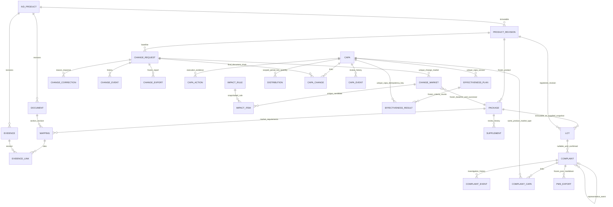

# IVD 변경 영향평가 · 시판 후 불만 · CAPA

모든 예시는 **가상 제품 · 검토용 예시**입니다. 합성 문서와 메타데이터만 사용합니다. 등록한 문서·증빙·제품 개정본을 연결하고 검토자의 판단을 보존하며, 실제 제품의 규제 적합성이나 보고 기한을 자동 결정하지 않습니다. 외부 기관 전송 기능은 없습니다.

## 실행과 마이그레이션

저장소 루트에서 기존 실행 환경을 사용합니다. Docker Compose는 시작 시 `alembic upgrade head`를 실행합니다.

```bash
pip install -r requirements.txt
python -m alembic upgrade head
python -m alembic current
QUEUE_MODE=thread python -m uvicorn backend.main:app --host 127.0.0.1 --port 8000
```

별도 터미널:

```bash
cd frontend
npm ci
npm run build
cd ..
python -m http.server 8080 --bind 127.0.0.1 --directory frontend/dist
```

PowerShell은 먼저 `$env:QUEUE_MODE='thread'`를 설정합니다. 기본 DB는 SQLite `local.db`이며 PostgreSQL은 `DATABASE_URL`로 선택합니다. 시각 기록은 UTC, 업무 날짜는 Asia/Seoul입니다. Windows용 시간대 데이터 `tzdata`를 의존성에 포함합니다.

`0005`는 제품 개정본·변경 요청·시장별 영향평가를 추가하고 기존 제품·패키지를 개정본 1에 연결합니다. `0006`은 로트·불만·CAPA·평가 계획·유통 자료·효과성 결과·이력·내보내기를 추가합니다. 다운그레이드는 새 테이블의 업무 데이터를 제거하므로 실제 자료가 있으면 먼저 백업해야 합니다. 테스트에서는 빈 신규 모듈을 내린 뒤 이전 모듈 데이터 보존을 확인합니다.

화면:

- 문서 패키지: `http://localhost:8080/?ivd=1`
- 제품 변경: `http://localhost:8080/?ivd_changes=1`
- 불만·CAPA: `http://localhost:8080/?pms=1`

## 요구사항 정의표

| ID | 검증 조건 | 근거 테스트 |
|---|---|---|
| CHG-001 | 요청 시 기준 제품 개정본·시장별 완료 패키지 고정, 승인 전 기존 자료 유지 | `test_name_impacts_markets_and_product_history`, `test_change_report_frozen_and_matches_revisions` |
| CHG-002 | 필드 규칙과 정확한 증빙 참조만 후보 생성, 미연결은 수동 확인 | `test_evidence_reference_impact_is_exact_and_idempotent`, 수동 확인 테스트 |
| CHG-003 | 시장별 판단 독립, 미확정·보완·수정 요청은 완료 제한 | `tests/test_ivd_changes.py`의 시장·보완·수정 요청 테스트 |
| CHG-004 | 기준 개정본/패키지 충돌 409, 확정 재전송 중복 방지, 원자적 시장 생성 | `test_actual_concurrent_confirmation_has_one_winner`, `test_package_baseline_conflict_without_product_revision_increment`, `test_multi_market_failure_rolls_back_product_and_packages` |
| PMS-001 | 미확인 로트 접수 후 제품·시장 검증하여 당시 개정본·문서 고정 연결 | `test_unknown_lot_confirmation_and_frozen_documents` |
| PMS-002 | 같은 제품·시장·확인 로트·유형의 대표 사건, 원본과 사건 수 분리 | `test_duplicate_receipts_and_root_cause_proof` |
| PMS-003 | 사실/가설/원인 분리, 원인 근거·검토자 필수, 보고 여부·기한 미확정 시작 | 위 원인 테스트, `test_reporting_source_and_deadline_not_automatic` |
| PMS-004 | 계획 사전 등록, 조치 실행 증빙과 효과성 결과 증빙 분리, 진행 변경은 종결 제한 | `test_plan_before_action_waiting_quantity_period_and_change_gate` |
| PMS-005 | 같은 기간·제품·시장·유형·로트 코호트의 사건/유통량으로 1,000개당 건수 산출 | `test_distribution_cohort_and_market_scope_are_validated` |
| PMS-006 | 수량 누락·관찰 미종료·로트 미확인·필수 조치/변경 미완료·결과 근거 누락은 평가 대기 | 계획/대기 테스트 |
| PMS-007 | 실패 시 재조치, 사전 계획 v2와 재평가 이력 보존, 같은 키 재전송 동일 결과 | `test_failed_effectiveness_rework_versioned_reassessment_and_idempotency` |
| PMS-008 | 토큰 없이 내보내기, 연결되지 않은 AI 인용 거부, 판정 변경 금지 | 위 재평가/내보내기 테스트, `test_ai_summary_rejects_unconnected_ids_without_workflow_change` |
| DB-006 | 새 모듈 마이그레이션과 이전 IVD 데이터 보존 | `test_pms_migration_preserves_ivd_revision_and_roundtrips` |

## 업무 규칙

변경 요청은 `초안 → 영향평가 → 재검토 → 내부 검토 완료`입니다. 재검토 중 수정 요청·답변 이력을 남길 수 있습니다. `기존 자료 유지`와 `해당 없음`은 판단 사유가 필요합니다. `개정 필요`에는 같은 제품·섹션의 더 높은 문서 개정본 또는 참조된 증빙의 후속 개정본이 필요합니다. 보완은 기준 패키지를 수정하지 않는 별도 작업 패키지에서 기존 보완 API를 재사용합니다. 확정은 제품 개정 번호의 조건부 갱신과 후속 패키지 생성을 한 트랜잭션으로 처리합니다. PostgreSQL의 행 잠금과 CAS를 사용하며, SQLite에서도 실제 동시 두 요청 중 하나만 성공하는 테스트를 실행합니다.

불만은 `확인 필요 / 조사 중`, CAPA는 `진행 중 / 종결`, 평가는 `평가 대기 / 기준 미달 / 통과`입니다. CAPA 종결 후 불만 접수 원본은 조사 기록으로 보존되고 CAPA의 종결 상태가 별도로 표시됩니다. 대표 사건은 같은 시장까지 확인하고 최초 접수일이 더 이른 원본을 지정합니다. 중복 접수는 삭제하지 않으며 사유·검토자를 이력에 저장합니다. 기간별 사건 분자는 대표 원본의 접수일을 기준으로 하여 다음 기간의 중복 접수를 새 사건으로 세지 않습니다. 미확인 로트가 해당 코호트에 포함될 가능성이 있으면 자동 통과하지 않습니다.

효과성 계획은 **필수 조치 또는 재조치 완료 전**에 등록합니다. 지표·전후 기간·로트 코호트·출처·허용 조치 후 발생률을 버전으로 저장하며, 조치 실행 기록이 사용한 계획 ID를 남깁니다. 관찰 시작일은 계획 등록일 이후여야 합니다. 유통 자료와 평가 결과는 기존 값을 덮어쓰지 않습니다. 수량 0은 계산 불가로 취급합니다. 분모는 같은 기간과 정확히 같은 로트 집합의 등록 유통 자료만 허용합니다. 결과에는 기준·분자 사건 ID·원본 건수·분모·증빙·검토자·시점을 고정합니다. 기준 미달은 재조치 항목을 자동 생성하고 새 계획을 완료 전에 등록하게 합니다. 최신 계획의 최신 평가가 통과해야 CAPA를 종결할 수 있습니다.

효과성 요청에는 `Idempotency-Key`가 필요합니다. `(CAPA ID, 키)`가 같고 본문이 같으면 기존 평가 ID·스냅샷을 반환합니다. 같은 키의 다른 본문은 409입니다. 데이터가 추가된 후 다시 평가하려면 새 키를 사용합니다. 과거 평가를 다시 계산하여 덮어쓰지 않습니다. 계획 개정 뒤에도 과거 키의 동일 요청은 원래 결과를 반환합니다.

가상 제품에서만 `synthetic:true`로 미래 접수·관찰 종료를 시연할 수 있으며 화면·보고서에 합성임을 표시합니다. 실제 경로는 미래 평가일을 거부합니다. 이 데모는 관찰 기간이 실제로 경과했거나 실제 유통·효과성을 검증했다는 뜻이 아닙니다.

## 주요 API

모든 경로는 `/ivd` 접두사이며 Swagger `/docs`에서 요청 스키마를 확인할 수 있습니다. 변경/조사/검토 작업에는 `reviewer`가 필수입니다. 최초 변경 요청은 `requester`를 받습니다.

| 메서드·경로 | 용도 |
|---|---|
| POST `/change-rules`, POST `/change-rules/sample` | 불변 버전의 필드-문서 연결 규칙 |
| GET `/products/{id}/revisions` | 확정 제품 개정본 |
| POST `/changes`, GET `/changes/{id}` | 기준 개정본·패키지를 고정한 변경 요청 |
| POST `/changes/{id}/assess`, `/start-review` | 연결 관계로 영향 후보 계산·재검토 시작 |
| POST `/changes/{id}/items/{item}/decision` | 개정/유지/해당 없음 판단 |
| POST `/changes/{id}/markets/{market}/decision` | 공식 근거·사유·검토자 시장 판단 |
| POST `/changes/{id}/markets/{market}/requests` | 별도 작업 패키지의 보완 요청 |
| POST `/changes/{id}/corrections`, `/corrections/{correction}/resolve` | 수정 요청·답변 |
| POST `/changes/{id}/approve`, `/exports` | 원자적 확정·고정 JSON/Markdown |
| POST/GET `/lots` | 제품·시장·번호별 유일 로트, 당시 문서 스냅샷 |
| POST/GET `/complaints` | 접수·목록 필터 `product_id,lot,market,status,owner` |
| GET `/complaints/{id}`, POST `/confirm-lot`, `/investigation`, `/duplicate`, `/reporting-review` | 상세·사후 로트·조사·사건 중복·보고 검토 (POST는 상세 경로 뒤에 추가) |
| POST `/complaints/{id}/capas`, `/capa-links` | 신규/기존 CAPA 연결 |
| GET `/capas/{id}`, POST `/capas/{id}/change-links` | CAPA와 기존 변경 요청 연결 |
| POST `/capas/{id}/actions`, `/actions/{action}/complete` | 조치·실행 증빙 |
| POST `/capas/{id}/plans`, `/distributions`, `/evaluations` | 사전 기준·유통 자료·효과성 평가 |
| POST `/capas/{id}/close` | 미완료 ID·사유를 포함한 409 또는 종결 기록 |
| POST `/complaints/{id}/summary` | 기본 `manual` 또는 선택 `huggingface` 내부 검토 요약 |
| POST `/complaints/{id}/exports`, GET `/pms-exports/{id}?format=json|markdown` | 로트 당시/최종 문서와 전체 이력 내보내기 |

평가 예:

```bash
curl -X POST http://localhost:8000/ivd/capas/CAPA_ID/evaluations \
  -H 'Content-Type: application/json' -H 'Idempotency-Key: capa-observation-01' \
  -d '{"reviewer":"내부 검토자","plan_id":"PLAN_ID","before_distribution_id":"BEFORE_ID","after_distribution_id":"AFTER_ID","result_evidence_ids":["EVIDENCE_ID"],"as_of":"2026-11-24","synthetic":false}'
```

선택 HF 요약은 기존 `HF_ANALYSIS_MODEL_ID`(없으면 `HF_MODEL_ID`)와 `HF_TOKEN`을 재사용합니다. 등록된 사실·명시적 가설/확인 원인·조치 기록을 입력 데이터로만 전달하고 도구를 제공하지 않습니다. 문장별 연결 근거 ID를 검증합니다. AI 결과는 상태/판정/기한을 저장하거나 변경하지 않습니다. 테스트는 가짜 공급자를 사용했으며 **실제 외부 AI 호출은 검증하지 않았습니다.** 기본 업무·요약 원문 조회·내보내기는 키가 필요 없습니다.

## 갱신 ERD



로트의 유일 제약은 `(product_id, market, number)`, 제품 개정본은 `(product_id, revision)`, 영향 후보는 `(market_id, candidate_key)`, 계획은 `(capa_id, version)`, 평가는 `(capa_id, idempotency_key)`입니다. 서버는 제품·시장·개정본·연결 근거를 교차 검증합니다. 보완/검토 이력은 패키지와 변경 요청/CAPA별로 분리합니다.

## 두 변경관리 데모 · 약 3분

```bash
python scripts/demo_ivd_changes.py
```

1. HIV EU: 완료 패키지의 성능 증빙을 후속 개정본으로 제안합니다. 그 증빙을 실제 참조한 성능 섹션 **1개만** 영향 후보입니다. 완료 제한 409를 확인합니다.
2. 작업용 보완 요청 → 답변 → 재검토 → 종결, 증빙 개정 판단과 EU 시장 판단을 기록합니다. 승인 재전송의 결과 ID가 같고 과거 패키지 내용이 그대로임을 확인합니다.
3. COVID-19 제품명 변경: KR·EU의 제품 개요/표시사항 **총 4개** 후보입니다. KR 판단을 저장해도 EU가 미확정으로 남습니다. 개정 문서를 연결하고 각각 판단한 뒤 제품 개정본·시장별 후속 패키지를 생성합니다.
4. `reports/ivd-changes/demo.json`, `hiv-eu-change.{json,md}`, `covid-name-change.{json,md}`를 확인합니다. 각 실행은 기존 현재 개정본을 조회해 새 합성 개정본을 생성합니다.

## 두 불만·CAPA 데모 · 약 3분

```bash
python scripts/demo_ivd_pms.py
python -m pytest tests -q -p no:cacheprovider
```

1. **0:00–0:45 HIV EU**: 이전 설명서 동봉 불만을 로트 미확인으로 접수합니다. 로트 원장을 확인하면 당시 제품·설명서 개정본이 연결되고 확인 이력이 남습니다. 관찰 사실/가설/근거 있는 확인 원인을 구분합니다.
2. **0:45–1:30 HIV**: CAPA 조치와 사전 효과성 계획 → 설명서 변경 요청 연결 → 진행 변경으로 종결 제한 409 → 수량 누락·관찰 미종료로 평가 대기. 표시사항 새 문서 버전과 변경 재검토를 확정한 뒤 합성 유통/평가 증빙을 등록합니다. 사건 발생률 **1 → 0건/1,000개**, 기준 **0.5 이하**로 통과하고 CAPA를 종결합니다. 옛 로트에서는 이전 설명서 ID가 유지됩니다.
3. **1:30–2:15 COVID-19 KR**: 외부 상자 로트 표기 누락의 같은 사건을 2회 접수합니다. 검토자가 대표 건에 연결하면 **원본 2건 / 사건 1건**입니다. 조치 후 새 사건 1건/유통 1,000개로 **1건/1,000개 > 0.5**, 첫 평가 기준 미달입니다.
4. **2:15–3:00 COVID-19**: 자동 생성된 재조치에 대해 실행 전 계획 v2 → 실행 증빙 → 새 관찰 구간 **0건/1,000개**로 통과합니다. 기준 미달과 통과, 계획 v1/v2를 모두 조회합니다. 동일 재평가 요청 키를 재전송해 같은 평가 ID임을 확인합니다. CAPA 종결 후 Markdown·JSON을 내보냅니다.

결과: `reports/ivd-pms/demo.json`, `hiv-outdated-ifu.{json,md}`, `covid-missing-label.{json,md}`. 스크립트는 테스트 클라이언트가 아닌 실행 중인 HTTP API를 사용합니다. 실행마다 고유 로트·증빙을 만들어 이전 기록을 보존합니다. 미래 관찰 기간을 명시적인 합성 모드로 시연하며 실제 관찰 종료로 주장하지 않습니다.

## 검증 범위

SQLite API·마이그레이션·동시 제품 확정 CAS·pytest·TypeScript·Vite 빌드 및 HTTP 데모를 로컬에서 검증합니다. Docker가 없는 환경에서는 Compose/PostgreSQL 행 잠금/Redis/RQ의 실제 통합은 미검증입니다. 실제 HIV/COVID 임상 성능, 실제 유통 자료, 실제품 보고 필요 여부·법정 기한을 검증하지 않았습니다. 공식 근거 등록 내역은 기존 `data/ivd_sources.json`과 `reports/ivd/source-verification.json`을 재사용하며 이번 PMS 데모에서 보고 조항·기한을 새로 공식 확인하거나 자동 확정하지 않습니다. 가상 시장 판단은 계속 ‘규제 검토 필요’입니다. 외부 배포·원격 푸시·기관 제출은 하지 않습니다.
